

# DeepGym

**Your training log, finally done right.**

A strength-training log for your phone and desktop.
Record sets, remember machine settings, reuse workout templates and follow
your training history and progress.

[Open DeepGym](https://www.deepgym.fit/) · [Українською](https://www.deepgym.fit/uk) · [По-русски](https://www.deepgym.fit/ru)

---

## Why DeepGym?

The public homepage is `/` (English), with `/uk` and `/ru` translations.
Signed-in users see their personal dashboard at `/`. Old `/about` links
redirect to the corresponding homepage.
SEO/PWA implementation and deployment follow-up: [SEO audit](docs/SEO_AUDIT.md).
Native store preparation: [mobile ASO](docs/MOBILE_ASO.md).

You're mid-workout. Rest timer is ticking. The last thing you want is a
clunky app with 12 taps to log one set. DeepGym is built around one idea:
**capture your training with zero friction, and turn it into insight.**

- 📱 **Installs from your browser** — add it to your home screen, with a local workout draft and no app-store download. Signing in, loading account data and saving workouts require internet.
- ⚡ **Fast logging** — the first set is created automatically, the next one copies the last, your working weight is pre-filled.
- 🧠 **Remembers what you can't** — machine seat heights, plate math, your numbers from three weeks ago.
- 📈 **Shows real progress** — charts and stats per exercise, not just a diary.
- ✨ **Starts configured** — a guided setup covers your language, profile, units, equipment and training week before the first workout.

---

## The tour

### Set it up once

New athletes — and existing accounts that still have no workouts — get a
five-step guided setup. Choose your language and pixel avatar, confirm kg/lb,
bar and plate defaults, then either build a fixed training week or explicitly
choose a flexible schedule. The final step explains how logging, equipment
memory, history and progress fit together.

The guide can be opened again any time from **Settings → App guide**.
Until the first session is saved, Home keeps a three-step checklist visible;
the workout form adds one contextual tip, and History confirms the first
successful log.

### Home — everything at a glance

Customize your Home with widgets for your week, recent sessions, exercise
progress, body weight and the next workout from your training schedule.
Move and resize widgets to keep the information you use within reach.

The screenshots below show the **web/PWA interface** with illustrative demo
data and English labels. They are not screenshots of the native Expo app.

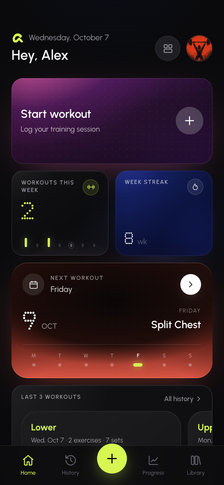

The desktop layout gives the same widgets more room and keeps quick navigation
in the bottom dock. Automatic mode follows the screen width; the layout can
also be selected in Settings.

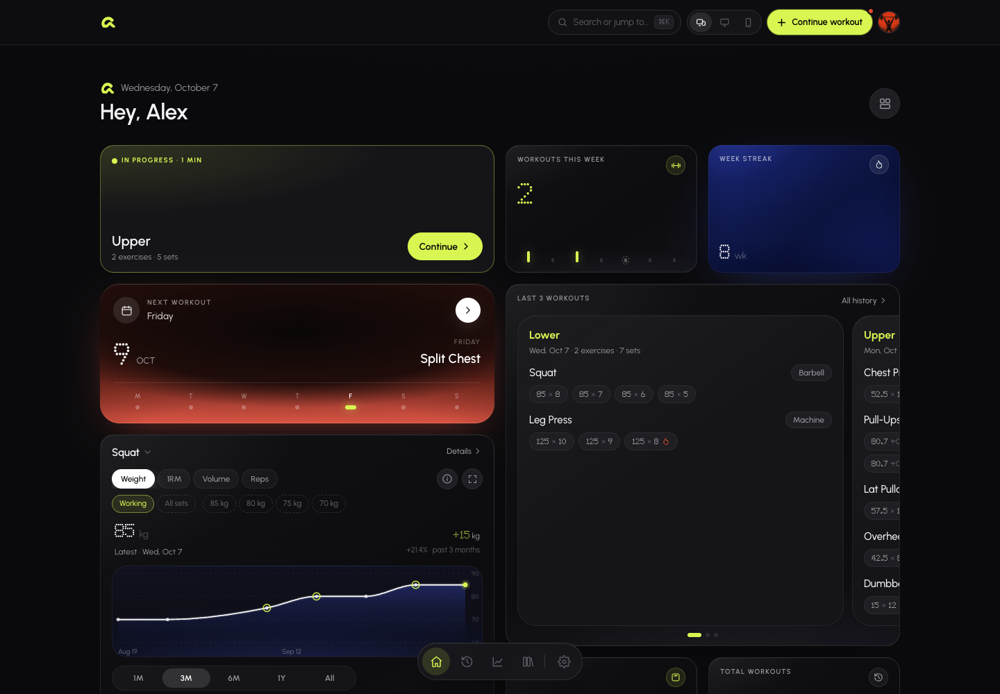

### Log a workout in seconds

Pick a workout type (Upper, Lower, Full Body, Push, Pull or a Split for any
muscle group), today's date is already set. Add exercises from your personal
catalog — or create a new one right there. Every exercise starts with one
set ready to fill; **＋ Add set** copies the previous one so you only change
what changed. Drag exercises into the order you want, and mark a set with 🔥
when you hit failure.

Had a rough day? Attach a note to the whole workout or to a single
exercise — *"slept 4 hours, kept it light"* — and it stays in your history.

Your draft is **saved as you type** on the device and synchronized to your
account while online. Return to it after closing the app, or continue on
another device after the cloud copy has synchronized.

Repeating a session? **Copy last** offers your most recent workout of the
selected type — and if your schedule runs the same type several times a
week, it matches the weekday, so a Sunday draft suggests last Sunday's
session. Need a different one? Open the **calendar picker** and copy any
past workout. Both flows let you choose between the complete session or one
empty set per exercise with its last non-empty weight.

Build reusable **workout templates** when the structure matters more than the
last result. Templates keep the workout type and exercise order, and start a
fresh draft with one empty set per exercise.

Bodyweight exercises use your latest recorded body weight as the base. Add a
plate with `+10`, log assisted pull-ups with `-20`, and DeepGym keeps the
session snapshot separate from your body-weight trend so a changing scale
number never masquerades as a strength PR.

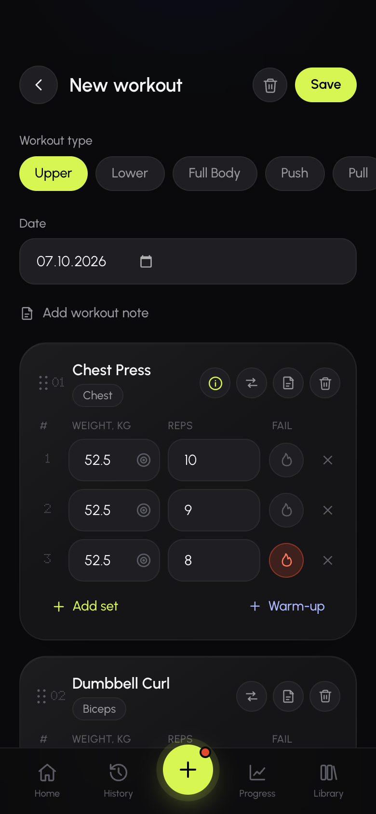

### Plate math, solved

Tap the ⊚ icon next to any weight and DeepGym shows **every reasonable way
to assemble it** from the plates your gym actually has — best option
(fewest plates) first:

- **Machine (plate-loaded):** `60 kg → 2 × 30 · 2 × 25 + 2 × 5 · 2 × 20 + 2 × 10 …`
- **Barbell:** the bar is subtracted automatically and the load is shown
  *per side* — `40 kg → bar + 1 × 10 per side, or 2 × 5, or 1 × 5 + 2 × 2.5…`
- **Dumbbells:** no fake plate math — `15 kg each, one in each hand, 30 kg total`
- **Crossover:** it's a cable stack, so no plate button at all — just type the weight

Your plate set is configurable in Settings, and each plate can be added in
**kg or lb** — mixed racks are fine.

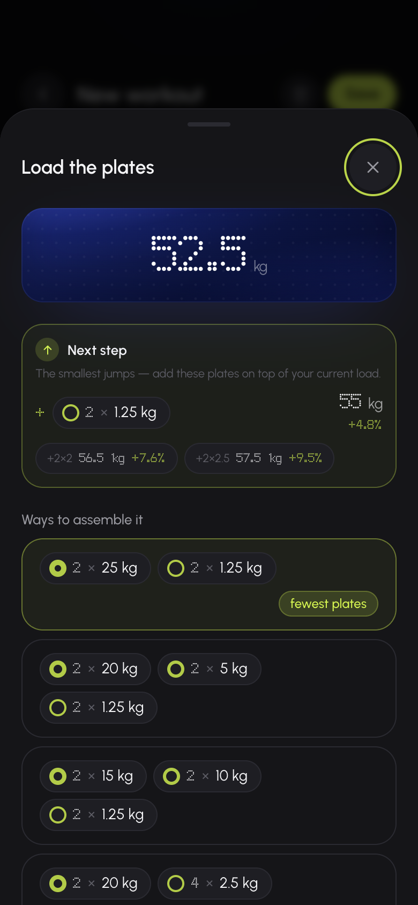
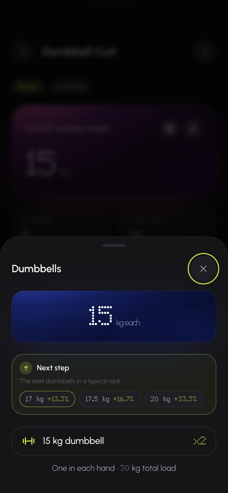

### Never re-adjust a machine from memory

For machine exercises, save your setup once — seat height, pad position,
grip — and it's always one tap away behind the ⓘ button, right inside your
workout.

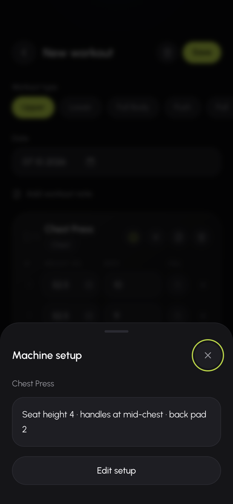

### Your exercise library

Exercises organized by muscle group — Back, Chest, Biceps, Triceps,
Shoulders, Legs, plus any group you add. Each shows its **current working
weight**, so you always know what to load. Create exercises directly from the
library, without starting a workout; Templates live here too.

Prefer pounds for a specific machine? Set a **per-exercise unit** (kg/lb) —
it overrides your default just for that exercise.

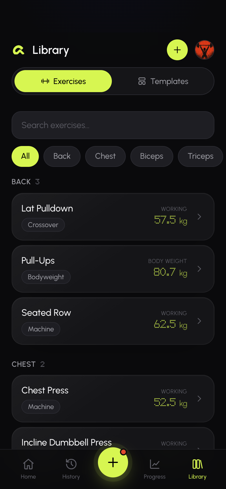

### Reusable workout templates

Open **Library → Templates** to keep your workout types and exercise order
ready for the next session. Start from the list or open a template to review
and edit it; each exercise begins with an empty set and its current weight.

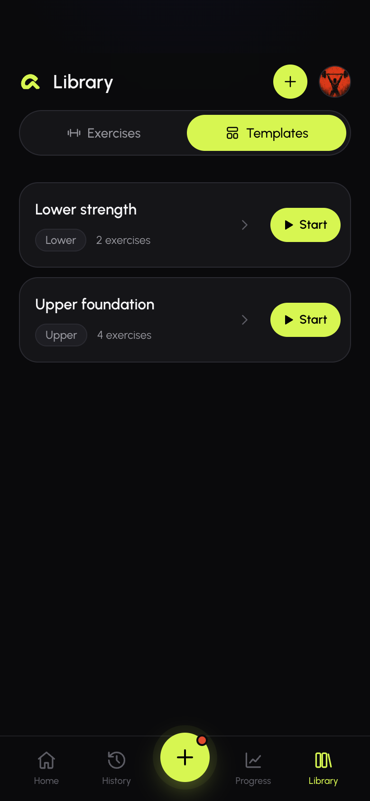

### Analytics that actually help

Open any exercise and see:

- **Working weight** — big, editable, with plate breakdown one tap away
- **Sessions, total sets, best weight, estimated 1RM**
- **Top-set progress chart** — your strength curve over time
- **Reps by weight** — average / median / most common reps at every weight
  you've used, so you know when it's time to move up

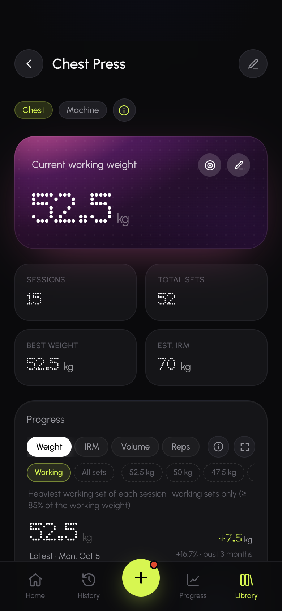

### Progress across your training

The **Progress** tab brings together period totals, weekly activity, exercise
trends, personal records, muscle-group balance and body-weight measurements.
Choose a period to review and filter by muscle group. Warm-up sets remain in
your log and are excluded from working-set statistics.

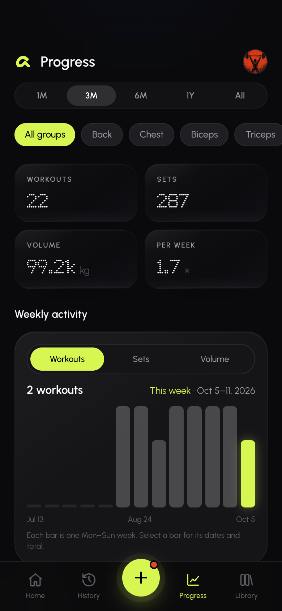

### History you can actually browse

Day, week or month view. Solid calendar dots show completed workouts and
hollow dots show upcoming sessions from your training week. Open any day to
review, edit, delete or start the planned session.

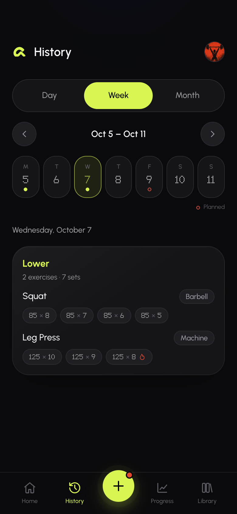
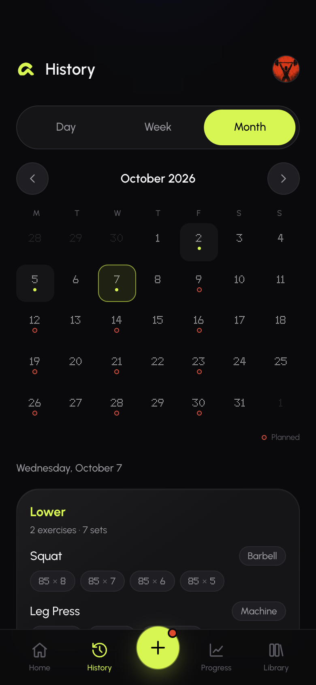

### Sign in your way

Google — one tap. Or Telegram: the DeepGym bot sends you a one-time code,
no password to remember, ever.

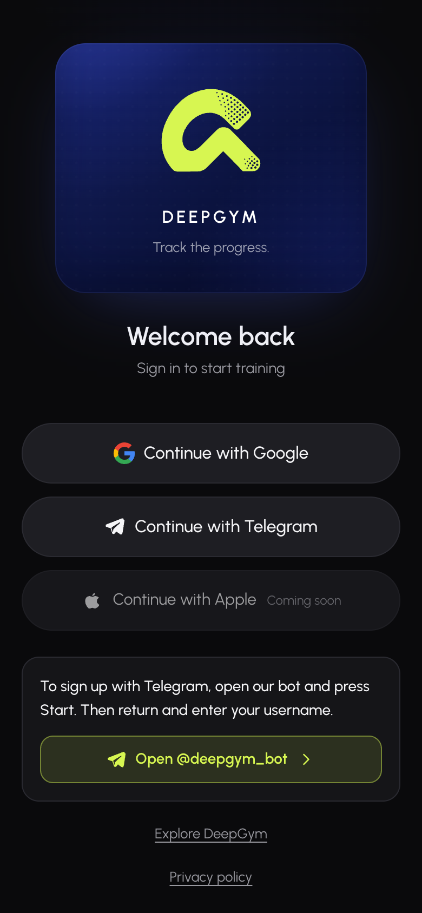

### Stay current without reading a changelog

After an update, DeepGym shows a single versioned **What's new** sheet on Home.
Acknowledgement is saved to your profile, so the same release is not announced
again on another visit or device. You can reopen the current release notes from
Settings whenever you want.

---

## Install it on your phone

1. Open [DeepGym](https://www.deepgym.fit/) in your browser.
2. **iPhone:** Share → *Add to Home Screen*. **Android:** menu → *Install app*.
3. Launch it from its own icon in an app window. Keep a connection for account
   data and workout saves; your draft also remains on the device.

---

## Quick reference

| Feature | Where |
| --- | --- |
| Start a workout | Home → **Start workout**, or the ➕ tab button |
| Reopen the product guide | Settings → **App guide** |
| See the current release notes | Settings → **What's new** |
| Add a set / mark failure | **＋ Add set** / flame button on the set row |
| Reorder exercises | Drag the numbered handle in the workout form |
| Copy a workout | New workout → **Copy last** or calendar → choose copy mode |
| Workout templates | Library → **Templates** |
| Record body weight | Settings → **Body weight**, or the bottom of a new workout |
| Create an exercise | Library → **Exercises** → **＋** |
| Review training trends | **Progress** tab → select a period |
| Customize Home | Home → edit widgets, or Settings → **Home screen** |
| Plate breakdown | ⊚ icon next to any weight |
| Machine setup notes | ⓘ button on machine exercises |
| Change working weight | Exercise page → edit button beside the working weight |
| kg ↔ lb (global) | Settings → Weight unit |
| kg ↔ lb (one exercise) | Exercise page → ✏️ → Weight unit |
| Your plates & bar | Settings → Plate calculator |
| Plan training days | Settings → Training week |
| Change avatar | Settings → Profile → Choose avatar |
| Custom muscle groups | Settings → Muscle groups |
| Phone/desktop layout | Settings → Interface; automatic mode follows screen width |
| Notes | "Add workout note" or the 📝 icon on any exercise |

---

## For developers

Want to self-host or hack on DeepGym? See **[SETUP.md](SETUP.md)** —
Supabase setup, Google OAuth, the Telegram bot, local development and
architecture notes (Next.js + TypeScript + SCSS modules + Supabase,
Feature-Sliced Design).

The Expo / React Native app lives in [`apps/mobile`](apps/mobile/README.md)
and shares domain logic through `packages/core`. It is a pre-release native
implementation; web/PWA availability does not imply App Store or Google Play
publication.
